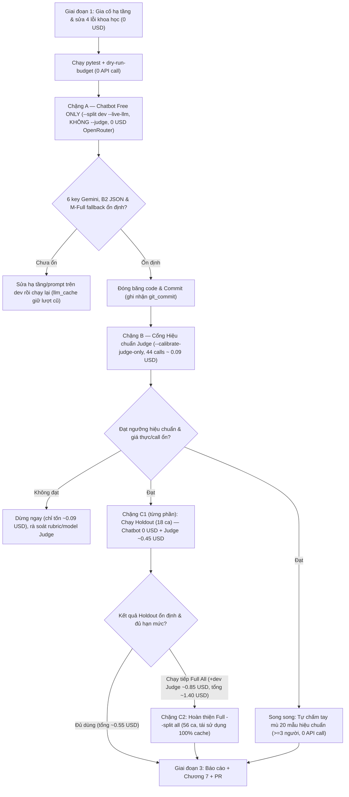

# Kế Hoạch Chạy Live Benchmark — Phân Hệ Multi-Agent Fashion Stylist Chatbot (Bản v3)

> **Trạng thái:** Đã chốt phương án (**Chatbot = ~6 key Gemini miễn phí trên Google AI Studio | Giám khảo = `openai/gpt-6.1-terra` với `reasoning.effort=low` qua OpenRouter hạn mức 2.00 USD**), bổ sung quy trình **tự chấm tay mù 20 mẫu hiệu chuẩn** và chạy kiểm chứng **từng phần qua các cổng Go/No-Go**.

---

## 1. Tóm Tắt Cấu Hình Chốt

| Hạng mục | Phương án chốt | Lý do chính |
| :--- | :--- | :--- |
| **Chatbot LLM (`M-Full` & `B2`)** | **Google AI Studio miễn phí** (~**6 key Gemini** từ nhiều tài khoản/project Google độc lập qua `GEMINI_API_KEYS`) | Tốn **0 USD OpenRouter**, đúng 100% provider & model production; `M-Full` và `B2` dùng **cùng 1 model** nên so sánh công bằng |
| **Cross-Family LLM Judge** | **`openai/gpt-6.1-terra`** (`reasoning.effort=low`) qua **OpenRouter** (hạn mức 2.00 USD) | Độc lập họ mô hình (*Cross-Family*), thế hệ 2026 tương xứng `gemini-3.6-flash`, giá chỉ **1.00 USD / 5.00 USD** mỗi 1M token (rẻ hơn `gpt-4.1` gần 40–50%) |
| **Chống mất tiền / mất quota** | **Bắt buộc `llm_cache.jsonl` + `judge_cache.jsonl`** trong `--cache-dir data/eval_cache` | Tách bước chạy Chatbot (0 USD OpenRouter) trước khi chấm Judge; đứt mạng hoặc chạm quota ngày chạy tiếp không mất lượt cũ |
| **Hệ thống so sánh Live** | **4 hệ thống lõi:** `B0` (Random), `B1` (Rule-DAG), `B2` (Single-Prompt Gemini), `M-Full` (Multi-Agent) | Bổ trợ trực tiếp cho báo cáo Offline v3 (`docs/archive/reports/MULTI_AGENT_OFFLINE_BENCHMARK_2026-11-22_v3.md`, đã có đủ 7 hệ thống ablation, 12 stress, 56 noise với 0 USD) |
| **Kỷ luật Holdout** | **Không dùng `--split smoke`** (vì chứa 4 ca holdout). Thử nghiệm & sửa lỗi chỉ trên **`--split dev` (38 ca)**; đóng băng code rồi mới chạy **`holdout` (18 ca)** / **`all` (56 ca)** | Tránh rò rỉ dữ liệu kiểm tra cuối (*data leakage*) |
| **Hiệu chuẩn + Chấm tay người thật** | Cổng hiệu chuẩn `44` lượt (~0.14 USD) **+ Tự chấm tay mù 20 mẫu** (bạn và 2–3 người) | Có **`human_vs_judge_spearman` thật** + độ đồng thuận liên người chấm; ghép điểm chấm tay sau **không tốn thêm lượt Judge** |
| **Thời tiết thực (`Open-Meteo`)** | **Tắt `--live-weather`** khi chấm benchmark; kiểm tra `Open-Meteo` thực bằng kịch bản riêng (0 USD) | Tránh thời tiết ngoài trời lúc chạy mâu thuẫn với nhãn thời tiết cố định trong bộ dữ liệu |

---

## 2. Luồng Thực Thi Từng Phần Qua Các Cổng Kiểm Soát



---

## 3. Phân Vai Rõ Ràng Giữa Offline v3 (Đã Xong) và Live v3 (Sắp Chạy)

| Trục đánh giá | Đã có ở Offline v3 (0 USD) | Bổ sung ở Live v3 |
| :--- | :--- | :--- |
| **Layer A — Grounding & An toàn** | 7 hệ thống, `56/56` ca `M-Full` đạt `100%` | Đo trực tiếp tỷ lệ **ảo giác ID món đồ**, sai cấu trúc, vi phạm `must_avoid` của `B2` so với `M-Full` |
| **B1 — Hiểu ngữ cảnh tiếng Việt (NLU)** | Rule-Only đạt `87.6%` micro-acc, trượt đúng 8 ca nói lóng/ngầm ý `r41–r48` | Đo mức cải thiện thực tế của **Live Gemini `ContextAgent`** trên `r41–r48` và tách `Dev` vs `Holdout` |
| **B2 — Chất lượng thời trang & Xếp hạng** | Chưa có | **`fashion_quality_score`** (chỉ số chính, không trộn văn phong giải thích), **`nDCG@3`**, **Pairwise 2 chiều đảo vị trí** (chỉ số phụ) chấm bởi `openai/gpt-6.1-terra` |
| **B3 — Cá nhân hóa & Contrastive** | `M-Full 100% (5/5)` vs `M-NoPersonalization 0% (0/5)`; Contrastive `100% (3/3)` | Xác nhận trên Live `M-Full` vs `B2` khi Judge nhận đủ hồ sơ sở thích |
| **B4 — Giải thích trung thực & tự nhiên** | Chỉ có template tất định | Đo tỷ lệ `gemini_batch` được chấp nhận, `Factuality` công bằng, `Cú pháp [Ngoặc]` và điểm `Usefulness` từ Judge |
| **B5 — Ablation vòng lặp, Stress & Noise** | Loop 1 `+5/-0`; Stress `12/12 (100%)`; Noise Top-1 Stability `73.3%` (`Core Jaccard 0.815`) | Giữ nguyên từ Offline v3, tắt `--include-stress` và `--include-noise` ở lượt Live chính để tiết kiệm chi phí |

---

## 4. Giai Đoạn 1 — Gia Cố Hạ Tầng & Sửa 4 Lỗi Khoa Học (0 USD)

Trước khi gọi bất kỳ API nào, thực hiện các nâng cấp gọn dưới đây (không làm thay đổi hợp đồng API production):

### 4.1. Sửa 4 vấn đề đã phát hiện khi rà soát mã nguồn
1. **Sửa thiên vị thời tiết của Judge (`backend/tests/evaluation/benchmark/runner.py`):**
   - Hiện tại Judge đọc `weather_condition` do chính hệ thống tự trích xuất (`res["context"]["weather_condition"]`), vô tình thiên vị `M-Full` khi `M-Full` hiểu sai thời tiết.
   - **Sửa:** Mọi hệ thống (`B0, B1, B2, M-Full`) đều được Judge chấm theo **nhãn chuẩn `expected_context.weather_condition`** (hoặc `"không nêu rõ"` nếu ca không nêu thời tiết).
2. **Bắt buộc lớp cache đầu ra LLM (`CachedLLMWrapper`):**
   - Lưu `data/eval_cache/llm_cache.jsonl` khóa theo `sha256(provider, model, prompt_payload)` cho cả `TelemetryLLMProbe` (`M-Full`) và `B2`. Đảm bảo bước chạy Chatbot Free (0 USD) tách rời bước chấm Judge và đầu ra tái lập 100% để `judge_cache.jsonl` trúng cache tuyệt đối.
3. **Bỏ `--split smoke` khỏi cổng sửa code:**
   - Do `--split smoke` có `15` ca gồm `4` ca `holdout` (`r09, r19, r27, r46`), toàn bộ bước thử nghiệm/tinh chỉnh chỉ thực hiện trên `--split dev`.
4. **Minh bạch nguồn điểm hiệu chuẩn người chấm:**
   - Tách rõ 2 chỉ số trong báo cáo hiệu chuẩn: `rubric_reference_spearman` (so với điểm tham chiếu sẵn trong fixture) và `human_vs_judge_spearman` (tính từ điểm trung bình **chấm tay mù của >= 3 người**).

### 4.2. Chi tiết file cần cập nhật ở Giai đoạn 1
- **`.gitignore`:** thêm `data/eval_cache/` và `data/private-judge-calibration-review/`.
- **`backend/app/services/context_providers.py` & `backend/app/core/dependencies.py`:**
  - Tích hợp `GeminiKeyPool` (xoay vòng 6 key + cooldown khi gặp `HTTP 429` + retry có giới hạn cho `429/503`) vào `GeminiContextProvider` và `get_context_llm_provider()`.
  - Thêm tham số tùy chọn `explanation_timeout_seconds` (production giữ nguyên `6s/8s`, benchmark đặt `20s` để tránh rớt oan về `deterministic_fallback`).
- **`backend/tests/evaluation/benchmark/systems.py`:**
  - `run_single_prompt_gemini_baseline` (`B2`) dùng chung `GeminiKeyPool`, retry `429/503`, pacing `--llm-delay-seconds` và `CachedLLMWrapper` với `M-Full`.
  - Đồng bộ cơ chế abort sau 3 lỗi liên tiếp (`AbortedLiveRunError`) cho `B2`.
- **`backend/tests/evaluation/benchmark/judge.py`:**
  - Retry tối đa 3 lần (backoff `1.5s -> 3s -> 6s`, tôn trọng `Retry-After`) cho `429/500/502/503/504`, timeout và lỗi mạng.
  - Gửi header `X-Title: Multi-Agent-Fashion-Stylist-Eval` khi gọi OpenRouter.
  - Hỗ trợ `BENCH_JUDGE_REASONING_EFFORT` (`low` mặc định cho `openai/gpt-6.1-terra`, tự động nâng `max_tokens=1024` để reasoning tokens không cắt cụt JSON), siết `rationale_vi`/`reason_vi` **ngắn gọn 1 câu (<= 30 từ)**.
  - Cộng dồn `prompt_tokens` và `completion_tokens` thực từ trường `usage` của phản hồi OpenRouter.
- **`backend/tests/evaluation/benchmark/runner.py`:**
  - Sửa lỗi thiên vị thời tiết khi gọi Judge (Pointwise & Pairwise).
  - Chỉ gọi Judge khi `run_complete == True` (chặn tuyệt đối tiêu tiền Judge trên lượt chạy bị abort).
  - Ghi đầy đủ metadata: `chatbot_model`, `gemini_key_count`, `judge_model`, `judge_reasoning_effort`, `llm_cache_hits`, `judge_cache_hits`, `judge_prompt_tokens`, `judge_completion_tokens`.
- **`backend/scripts/evaluate_multi_agent_chatbot.py`:**
  - Thêm `_load_dotenv_defaults()` nạp an toàn `BENCH_JUDGE_*` từ `.env` mà không ghi đè `os.environ` và không bao giờ in giá trị key.
  - Thêm cờ `--llm-delay-seconds`, `--explanation-timeout` (mặc định `20.0`), `--judge-reasoning-effort`, `--no-llm-cache`.
- **Công cụ hỗ trợ tự chấm tay mù 20 mẫu hiệu chuẩn (Offline HTML + Script ghép điểm):**
  - Tạo script sinh trang HTML chấm mù offline (tương tự bộ review Try-On) cho **20 mẫu hiệu chuẩn** trong `data/fixtures/judge_calibration_v1.json`: xáo trộn ngẫu nhiên thứ tự, **ẩn hoàn toàn nhãn `good/mediocre/bad` và điểm `gpt-6.1-terra`**, mỗi người chấm 1–5 rồi xuất file `calibration_ratings_<ten>.json`.
  - Script tổng hợp tính điểm trung bình liên người chấm, độ đồng thuận giữa người chấm (pairwise Spearman / MAE) và **`human_vs_judge_spearman`** trực tiếp so với kết quả `gpt-6.1-terra` đã lưu (**0 API call bổ sung**).
- **`backend/tests/evaluation/test_multi_agent_benchmark.py`:**
  - Bổ sung 9 unit test offline kiểm chứng: `.env` loader, Judge retry 429, `reasoning.effort` + `max_tokens`, chặn Judge khi abort, `B2` abort 3 lỗi liên tiếp, `GeminiKeyPool` xoay vòng, Judge dùng thời tiết nhãn chuẩn, `CachedLLMWrapper` trúng cache và quy trình chấm tay mù.

---

## 5. Giai Đoạn 2 — Quy Trình Chạy Live Từng Phần

### Bước B0 — Chuẩn bị `.env` cục bộ (tự điền trên máy, không gửi lên chat)

```dotenv
# ~6 API key Gemini miễn phí từ các tài khoản Google khác nhau (cách nhau bằng dấu phẩy)
GEMINI_API_KEYS=key1,key2,key3,key4,key5,key6
CONTEXT_PROVIDER=gemini
LLM_MODEL=<model Gemini production của bạn, ví dụ gemini-2.5-flash>

# OpenRouter chỉ dùng cho Cross-Family Judge (đặt Credit Limit = 2.00 USD trên OpenRouter)
BENCH_JUDGE_PROVIDER=openai_compatible
BENCH_JUDGE_BASE_URL=https://openrouter.ai/api/v1
BENCH_JUDGE_MODEL=openai/gpt-6.1-terra
BENCH_JUDGE_REASONING_EFFORT=low
BENCH_JUDGE_API_KEY=<OPENROUTER_KEY_CUA_BAN>
```

### Bước B1 — Kiểm tra ngân sách dự toán (0 API call)

```powershell
backend\.venv\Scripts\python.exe backend/scripts/evaluate_multi_agent_chatbot.py --systems B0,B1,B2,M-Full --split all --live-llm --judge --dry-run-budget
```

- **Kỳ vọng:** `estimated_gemini_calls = 164`, `estimated_judge_calls = 642`.

### Chặng A — Kiểm tra Chatbot Free trước (`--split dev`, KHÔNG `--judge`, 0 USD OpenRouter)

```powershell
backend\.venv\Scripts\python.exe backend/scripts/evaluate_multi_agent_chatbot.py --systems B0,B1,B2,M-Full --split dev --live-llm --llm-delay-seconds 1.5 --cache-dir data/eval_cache --report-json docs/archive/reports/LIVE_DEV_CHATBOT_ONLY_<YYYY-MM-DD>.json --report-md docs/archive/reports/LIVE_DEV_CHATBOT_ONLY_<YYYY-MM-DD>.md
```

- **Chi phí OpenRouter:** **0.00 USD** (chỉ gọi `110` lượt Gemini trên 6 key Free).
- **Điều kiện qua Chặng A:**
  - `run_complete == true` (nếu chạm quota ngày giữa chừng, `llm_cache.jsonl` giữ toàn bộ ca đã xong để chạy tiếp).
  - `M-Full`: `rules_fallback < 10%`, `deterministic_fallback < 15%`, các ca nói lóng `dev` (`r41–r45`) cải thiện rõ so với Offline v3.
  - `B2`: tỷ lệ parse JSON thành công `>= 90%`.
- **Đóng băng:** Nếu cần tinh chỉnh hạ tầng/prompt dựa trên ca `dev`, chỉnh xong và chạy lại Chặng A đến khi ổn định, rồi **commit code để đóng băng `git_commit`**.

### Chặng B — Cổng Hiệu chuẩn Judge `openai/gpt-6.1-terra` (`44` calls ~ 0.08–0.11 USD)

```powershell
backend\.venv\Scripts\python.exe backend/scripts/evaluate_multi_agent_chatbot.py --calibrate-judge-only --cache-dir data/eval_cache --report-json docs/archive/reports/JUDGE_CALIBRATION_GPT61_TERRA_<YYYY-MM-DD>.json
```

- **Tiêu chí Go / No-Go:**
  - `same_family_judge_bias == false`
  - `pointwise_accuracy >= 85%` (`>= 17/20`)
  - `pairwise_accuracy >= 90%` (`>= 11/12`)
  - `position_consistency_rate >= 90%` (`>= 11/12`)
  - `rubric_reference_spearman >= 0.80`
- **Kiểm tra giá thực ngay tại đây:** Đọc `judge_usage_tokens` và OpenRouter Activity để tính chính xác `USD/call` thực tế (`x 251` cho `holdout`, `x 642` cho `all`).

### Chặng B+ — Quy trình Tự Chấm Tay Mù 20 Mẫu Hiệu Chuẩn (0 API call, làm song song)

1. Mở trang HTML chấm mù sinh từ `data/fixtures/judge_calibration_v1.json`, gửi cho **>= 3 người chấm** (ẩn nhãn `good/mediocre/bad` và ẩn điểm `gpt-6.1-terra`).
2. Mỗi người chấm 20 mẫu theo thang **1–5** cho 3 tiêu chí thời trang (`hợp dịp`, `hợp thời tiết/thoải mái`, `hài hòa thẩm mỹ`) + `độ hữu ích giải thích` (~10 phút/người) và xuất file JSON.
3. Chạy script tổng hợp để ghép với file kết quả Chặng B -> xuất bảng **Inter-Rater Agreement** và **`human_vs_judge_spearman` thật** cho Chương 7.

### Chặng C — Chạy Chốt Live Benchmark (Từng phần `Holdout` trước, rồi mở rộng `All`)

- **Bước C1 — Chạy Holdout (18 ca) trước để kiểm chứng trọn vẹn:**

```powershell
backend\.venv\Scripts\python.exe backend/scripts/evaluate_multi_agent_chatbot.py --systems B0,B1,B2,M-Full --split holdout --live-llm --judge --llm-delay-seconds 1.5 --cache-dir data/eval_cache --report-json docs/archive/reports/LIVE_MULTI_AGENT_BENCHMARK_HOLDOUT_<YYYY-MM-DD>.json --report-md docs/archive/reports/LIVE_MULTI_AGENT_BENCHMARK_HOLDOUT_<YYYY-MM-DD>.md
```

  - Phát sinh: `54` Gemini Free (0 USD) + `207` Judge mới (44 lượt hiệu chuẩn đã cache) ~ **0.38–0.52 USD** (cộng dồn sau B + C1 mới khoảng **0.46–0.63 USD**, còn dư hơn 1.35 USD trong hạn mức 2.00 USD).
  - **Không sửa code** để cải thiện điểm sau khi đã xem kết quả Holdout.

- **Bước C2 — Hoàn thiện Full `--split all` (56 ca = `38 dev + 18 holdout`):**

```powershell
backend\.venv\Scripts\python.exe backend/scripts/evaluate_multi_agent_chatbot.py --systems B0,B1,B2,M-Full --split all --live-llm --judge --llm-delay-seconds 1.5 --cache-dir data/eval_cache --report-json docs/archive/reports/LIVE_MULTI_AGENT_BENCHMARK_<YYYY-MM-DD>.json --report-md docs/archive/reports/LIVE_MULTI_AGENT_BENCHMARK_<YYYY-MM-DD>.md
```

  - Nhờ `llm_cache.jsonl` + `judge_cache.jsonl`: `164/164` lượt Gemini đều đã cache (0 lượt Gemini mới) và `251` lượt Judge đã cache -> chỉ phát sinh **`391` lượt Judge mới cho phần `dev`** ~ **0.75–0.98 USD**.
  - **Tổng cộng dồn toàn bộ (B + C1 + C2):** ~**1.21–1.61 USD** (nằm thoải mái trong hạn mức **2.00 USD** OpenRouter).

- **Kiểm chứng phụ trợ `Open-Meteo` thực (tách riêng, 0 USD):**
  - Chạy riêng `backend/scripts/evaluate_weather_context.py` để ghi nhận độ trễ & tỷ lệ phản hồi của `Open-Meteo` thực tế.

---

## 6. Bảng Tổng Hợp Dự Toán Chi Phí & Lượt Gọi (Hạn Mức 2.00 USD OpenRouter)

*(Đơn giá OpenRouter của `openai/gpt-6.1-terra`: 1.00 USD / 1M input tokens, 5.00 USD / 1M output tokens. Với `reasoning.effort=low` và `rationale_vi` ngắn 1 câu, chi phí kỳ vọng khoảng **0.0019–0.0025 USD / lượt Judge**).*

| Chặng | Gemini Free Calls | Judge Calls mới (`gpt-6.1-terra`) | Chi phí OpenRouter phát sinh | Cộng dồn OpenRouter |
| :--- | :---: | :---: | :---: | :---: |
| **Giai đoạn 1:** Code + `pytest` + `dry-run` | `0` | `0` | **0.00 USD** | **0.00 USD** |
| **Chặng A:** Chatbot Only (`--split dev`, 38 ca) | `110` *(6 key Free)* | `0` | **0.00 USD** | **0.00 USD** |
| **Chặng B:** Hiệu chuẩn Judge (`--calibrate-judge-only`) | `0` | `44` | **~0.08–0.11 USD** | **~0.08–0.11 USD** |
| **Chặng B+:** Tự chấm tay mù 20 mẫu (>= 3 người) | `0` | `0` | **0.00 USD** | **~0.08–0.11 USD** |
| **Chặng C1:** Chạy `holdout` (18 ca) | `54` *(6 key Free)* | `207` *(44 cal cache)* | **~0.38–0.52 USD** | **~0.46–0.63 USD** |
| **Chặng C2:** Mở rộng lên `all` (56 ca) | `0` *(164 cache)* | `391` *(251 cache)* | **~0.75–0.98 USD** | **~1.21–1.61 USD** |

---

## 7. Giai Đoạn 3 — Phân Tích, Viết Chương 7 & Đóng PR

1. **Tổng hợp bảng số liệu khóa luận:**
   - Đối chiếu **Offline v3 (7 hệ thống + Stress + Noise)** với **Live v3 (`B0, B1, B2, M-Full`)**, tách rõ **`Dev` (`n=38`)** và **`Holdout` (`n=18`)**, kèm mẫu số (`k/n`) và khoảng tin cậy 95% (`Wilson CI` / `Bootstrap CI`).
   - Trình bày bảng **Hiệu chuẩn Giám khảo** kèm độ đồng thuận liên người chấm và **`human_vs_judge_spearman`** từ bước tự chấm tay.
   - Phân tích 2–3 case study đối chiếu (`M-Full` vs `B2`) cùng mục *Threats to Validity* trung thực.
2. **Xuất bản thảo Chương 7:** lưu trong thư mục `docs/archive/reports/` với tên `CHUONG_7_DANH_GIA_MULTI_AGENT_CHATBOT_<YYYY-MM-DD>.md`.
3. **Đồng bộ tài liệu & PR:** cập nhật `CURRENT_STATE.md` (giữ nguyên toàn bộ mục Phase 1/2/3), chạy đủ kiểm chứng tự động và chỉ stage các file hợp lệ.

---

## 8. Kế Hoạch Kiểm Chứng (Verification Checklist)

### 8.1. Lệnh kiểm thử tự động

```powershell
# 1. Backend tests (Offline, 0 API call)
cd d:\DO_AN\Multi-Agent-Fashion-Stylist\backend; .venv\Scripts\python.exe -m pytest -q

# 2. Kiểm tra tính toàn vẹn tài liệu
cd d:\DO_AN\Multi-Agent-Fashion-Stylist; powershell -ExecutionPolicy Bypass -File scripts/verify_documentation.ps1

# 3. Frontend không hồi quy (luôn chạy từ đường dẫn ổ D:\ in hoa)
cd D:\DO_AN\Multi-Agent-Fashion-Stylist\frontend; npm test; npm run type-check
```

### 8.2. Tiêu chí nghiệm thu báo cáo Live

- [ ] `metadata.run_complete == true` và `aborted_reason == null`.
- [ ] `judge_model == "openai/gpt-6.1-terra"`, `same_family_judge_bias == false`.
- [ ] `M-Full` và `B2` chạy trên **cùng một `chatbot_model`** (Google AI Studio), ghi rõ `git_commit`.
- [ ] Judge chấm mọi hệ thống theo **thời tiết nhãn chuẩn** (không thiên vị theo ngữ cảnh tự trích).
- [ ] Báo cáo ghi rõ `prompt_tokens`, `completion_tokens`, chi phí thực tế, `k/n`, 95% CI và `human_vs_judge_spearman` từ bước tự chấm tay.
- [ ] Không lộ API key hay file cache trong báo cáo, log hoặc `git status`.
